<div align="center">




**I build intelligent systems and the tools around them.** My work spans applied AI, developer infrastructure, and interactive software—turning difficult problems into useful, testable products.

[](https://www.circuitnotion.com) [](https://x.com/circuitnotion) [](https://github.com/ntirushwajeanmarc?tab=followers) [](https://github.com/ntirushwajeanmarc)

</div>

```console
ntirushwa@circuitnotion:~$ whoami
  role      : AI engineer / systems builder
  base      : Rwanda, building for a global network
  mission   : turn hard problems into systems that actually run
  mode      : research -> prototype -> product -> measure
ntirushwa@circuitnotion:~$ _
```

---

## `01 / OPERATOR PROFILE`

Engineer and builder at **[CircuitNotion](https://www.circuitnotion.com)**. I work across machine-learning prototypes, AI-enabled products, open-source tooling, and experiments that connect software to the physical world.

My operating loop: identify a real need → design a technical approach → build a usable system → evaluate what happens in practice. I care about useful outcomes, clear engineering, and making complex technology accessible.

<div align="center"></div>

## `02 / LIVE TELEMETRY`

Real numbers from the public record—no vanity metrics, no invented claims.

<div align="center">




</div>

<div align="center"></div>

## `03 / ACTIVE SYSTEMS`

<table>
<tr>
<td width="50%" valign="top">
<h3>🌱 AGRICULTURE GHG & YIELD ML</h3>
<p>ML pipeline predicting crop yield and greenhouse-gas emissions (N₂O, CO₂, CH₄) from soil, weather, and farm-management features.</p>
<p><code>Python</code> · <code>Machine Learning</code> · <code>Climate</code></p>
<a href="https://github.com/ntirushwajeanmarc/agriculture-ghg-yield-ml">OPEN PROJECT ↗</a>
</td>
<td width="50%" valign="top">
<h3>🏎️ ASTRA RACER</h3>
<p>3D arcade racer for Godot 4.7 with bicycle-model car physics, real lateral slip, corner-aware AI opponents, three circuits, and an offline asset pipeline from GPX, SRTM elevation and OSM data.</p>
<p><code>GDScript</code> · <code>Godot</code> · <code>Procedural</code></p>
<a href="https://github.com/ntirushwajeanmarc/astra-racer">OPEN PROJECT ↗</a>
</td>
</tr>
<tr>
<td width="50%" valign="top">
<h3>🧩 CN MCP SDK</h3>
<p>Open-source Python SDK for the CircuitNotion MCP library—a focused interface for building against its MCP tooling.</p>
<p><code>Python</code> · <code>MCP</code> · <code>SDK</code></p>
<a href="https://github.com/ntirushwajeanmarc/cn-mcp-sdk">OPEN PROJECT ↗</a>
</td>
<td width="50%" valign="top">
<h3>🗣️ KINYA-GPT</h3>
<p>Language-technology and generative-AI exploration focused on bringing modern AI capabilities into a local-language context.</p>
<p><code>Python</code> · <code>Jupyter</code> · <code>GenAI</code></p>
<a href="https://github.com/ntirushwajeanmarc/kinya-gpt">OPEN PROJECT ↗</a>
</td>
</tr>
<tr>
<td width="50%" valign="top">
<h3>⚡ CIRCUITNOTION</h3>
<p>The open-source CircuitNotion core at the centre of the ecosystem—the system the rest of the stack is built around.</p>
<p><code>C++</code> · <code>Systems</code> · <code>Open Source</code></p>
<a href="https://github.com/ntirushwajeanmarc/CircuitNotion">OPEN PROJECT ↗</a>
</td>
<td width="50%" valign="top">
<h3>🔌 CIRCUITNOTION APIS</h3>
<p>Service layer behind the CircuitNotion platform—API surface for the products and clients around it.</p>
<p><code>Python</code> · <code>APIs</code> · <code>Backend</code></p>
<a href="https://github.com/ntirushwajeanmarc/circuitnotion_apis">OPEN PROJECT ↗</a>
</td>
</tr>
</table>

**Additional signal:** [All repositories](https://github.com/ntirushwajeanmarc?tab=repositories) · [Follow the work](https://github.com/ntirushwajeanmarc?tab=followers)

<div align="center"></div>

## `04 / ENGINEERING DOCTRINE`

- **Truth over hype.** A system that demos well but fails quietly is not finished. Behaviour gets measured before it gets announced.
- **Depth in the hard part.** Physics that actually slips, datasets that actually generalise, pipelines that actually run end to end.
- **Tools as leverage.** Good SDKs and integrations multiply what everyone after you can build—so they deserve the same care as products.
- **Ship the loop.** Understand the need, shape the approach, build the thing, learn from the result. Repeat.

<div align="center"></div>

## `05 / RESEARCH VECTORS`

| VECTOR | CURRENT INTEREST |
| --- | --- |
| **Applied AI** | Machine learning, generative AI, intelligent agents, and practical AI products |
| **Developer infrastructure** | Open-source SDKs, integrations, and workflows that make technology easier to use |
| **Interactive systems** | Game development, simulation, and responsive experiences |
| **Physical computing** | Embedded projects and software connected to real-world environments |

<div align="center"></div>

## `06 / LANGUAGE FOOTPRINT`

Primary language across public repositories—not a claim of expertise, just what the work is written in.

| LANGUAGE | PUBLIC REPOS |
| --- | --- |
| Python | 30 |
| TypeScript | 24 |
| JavaScript | 22 |
| HTML | 6 |
| Go | 5 |
| C++ | 3 |
| Java | 3 |
| Dart | 2 |
| Jupyter Notebook | 2 |
| PLpgSQL | 2 |
| C | 1 |
| GDScript | 1 |
| Shell | 1 |

<div align="center"></div>

## `07 / TOOLCHAIN`

<div align="center">

     

     


</div>

**CORE**<br>
`Python` · `TypeScript` · `JavaScript` · `Go` · `C/C++` · `GDScript`

**PLATFORM**<br>
`Machine Learning` · `Generative AI` · `AI Agents` · `MCP` · `Godot` · `Dart` · `PostgreSQL`

**PRACTICE**<br>
`Data pipelines` · `API design` · `Open-source SDKs` · `Simulation` · `Embedded Systems`

<div align="center"></div>

## `08 / CONTACT CHANNELS`

🌐 [CIRCUITNOTION.COM](https://www.circuitnotion.com) &nbsp;·&nbsp; 𝕏 [@CIRCUITNOTION](https://x.com/circuitnotion) &nbsp;·&nbsp; 🧑‍💻 [GITHUB / NTIRUSHWAJEANMARC](https://github.com/ntirushwajeanmarc)

<div align="center">

`END OF TRANSMISSION` &nbsp;·&nbsp; *Explore a system, follow the work, or bring a hard problem.*

</div>
